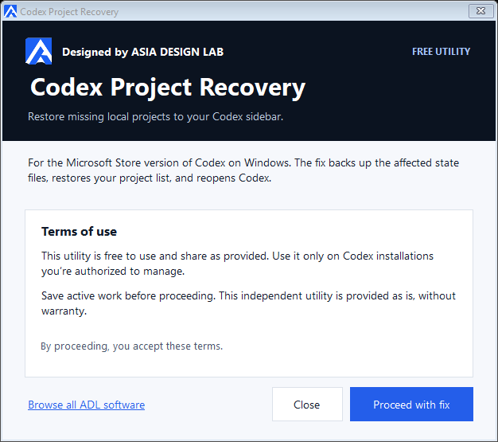

# Codex Project Recovery

A free Windows utility by **ASIA DESIGN LAB** for restoring missing local projects in the Codex sidebar. It supports the Microsoft Store version of Codex Desktop on Windows 11.

**[Download CodexProjectRecovery.exe](https://github.com/AsiaDesignLab/codex-project-recovery/releases/download/v1.1.0/CodexProjectRecovery.exe)** · [Release and SHA-256 checksum](https://github.com/AsiaDesignLab/codex-project-recovery/releases/tag/v1.1.0) · [ADL Software](https://www.adlsoftware.net/)



## Run the fix

1. Save any active work in Codex.
2. Download and open `CodexProjectRecovery.exe`.
3. Read the terms and select **Proceed with fix**. If Codex stays open, choose **Quit** from its Windows notification area icon.
4. Check **Projects** after Codex reopens. The tool reports the backup folder and any project records it skipped.

## What it does

The utility reads existing local project records from the Codex SQLite database and rebuilds missing entries in the sidebar registry. It closes Codex before writing the registry and backs up the affected files first. Recovery requires intact project records and access to the original folders.

The default state location is `%USERPROFILE%\.codex`. The utility honors `CODEX_HOME` when set. It saves backups under `%LOCALAPPDATA%\CodexProjectRecovery\Backups`. Keep backups private because they can contain chat and local configuration data.

## Verify the download

Run these commands in PowerShell from the folder containing the executable.

```powershell
Get-AuthenticodeSignature -LiteralPath .\CodexProjectRecovery.exe
Get-FileHash -LiteralPath .\CodexProjectRecovery.exe -Algorithm SHA256
```

Check that the signature status is `Valid` and compare the SHA-256 hash with `SHA256SUMS.txt` from the release.

## Troubleshooting

- **No recoverable projects are missing.** Check that you're running the utility from the same Windows profile as Codex.
- **Saved folder unavailable.** Reconnect the drive or restore access to the original project folder, then run the tool again.
- **Unsupported state or failed integrity check.** Keep the original state files and any backups. The utility needs a readable registry and an intact SQLite database.
- **Undo the repair.** Fully quit Codex, save a copy of your current `.codex-global-state.json`, then copy the original JSON from the reported backup folder back to your Codex state directory.

[Terms of use](TERMS.md) · [Original community recovery guide](https://www.reddit.com/r/codex/comments/1x3vuqi/solved_codex_projects_disappeared_after/)
